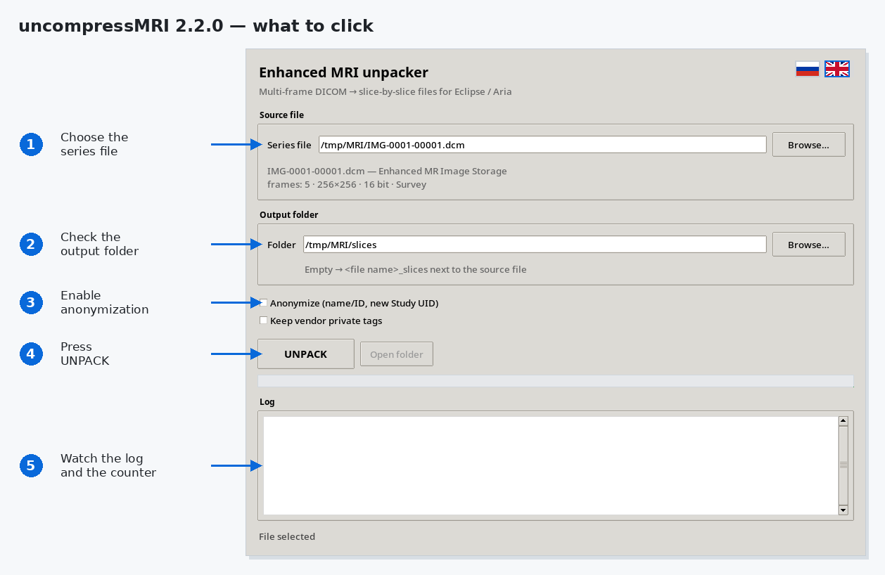
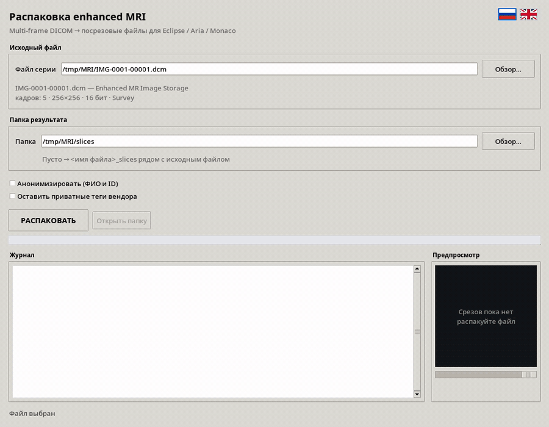
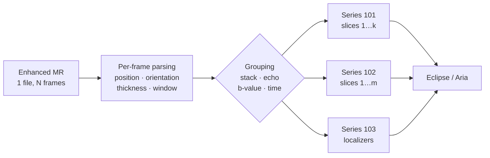

# uncompressMRI

**Splits an enhanced (multi-frame) MRI series into ordinary slice-by-slice DICOM
files that Eclipse / Aria can import.**

[](https://github.com/loonies321/uncompressMRI/releases/latest)
[](https://github.com/loonies321/uncompressMRI/actions/workflows/build-windows-exe.yml)
[](https://www.python.org/)
[](LICENCE.txt)

🇷🇺 [Русская версия](README.md) · **English**



**[Download uncompressMRI.exe](https://github.com/loonies321/uncompressMRI/releases/latest)** —
Windows x64, ~25 MB, no Python required.
Or [run it from source](#from-source).

---

## Why this exists

A scanner (Philips, for example) can write the whole series into one file —
`Enhanced MR Image Storage`, with dozens of frames inside. Eclipse and Aria do
not accept such files: they expect a set of plain `MR Image Storage` files, one
per slice.

uncompressMRI splits the multi-frame file back into slices and keeps the
geometry of **each** frame instead of an average:

| | |
|---|---|
| **Before** | 1 file, 5 frames, 3 stacks, geometry hidden in per-frame functional groups |
| **After** | 5 files, 3 series; every slice has its own `ImagePositionPatient`, `SliceLocation`, `InstanceNumber` |

## Three steps

1. **Pick the series file** — the “Browse…” button or paste a path into the
   field. The header immediately shows what is inside: SOP class, frame count,
   matrix, series description. If it says `Enhanced MR Image Storage`, this is
   the right file.
2. **Check the output folder** — defaults to `<file name>_slices` next to the
   source file.
3. **Press `РАСПАКОВАТЬ` (Unpack)** — the progress bar shows
   `written / total`, the log lists the resulting series, and “Open folder”
   takes you to the result.

Hotkeys: `Enter` — unpack, `Ctrl+O` — choose a file, `Esc` — close.

The interface language is switched with the **RU / EN** flags in the top-right
corner (the flags are painted on a `Canvas`, no image files involved) and the
choice is remembered between runs.



## What you get in the folder

```text
IMG-0001-00001_slices/
├── IM_101_0001.dcm   ← series 101, slice 1
├── IM_101_0002.dcm
├── IM_101_0003.dcm
├── IM_102_0001.dcm   ← series 102, another stack
└── IM_103_0001.dcm   ← series 103, a localizer in another plane
```

File name: `IM_<series number>_<slice number>.dcm`. Every series gets its own
`SeriesInstanceUID`, so series never get mixed up in the TPS even when they sit
in one folder.

| Field | What happens to it |
|---|---|
| `SOPInstanceUID` | new, deterministic: a repeated run produces the same values |
| `SeriesInstanceUID` | new, one per series |
| `StudyInstanceUID` | **preserved** — slices land in the same study |
| `FrameOfReferenceUID` | **preserved** — geometry stays tied to the source |
| `ImagePositionPatient`, `SliceLocation` | from the per-frame functional groups of **each** frame |
| `Rows`, `Columns`, `BitsStored` | from the source; 12 bits in 16 stay 12 bits |
| Vendor private tags | removed; keep them with `--keep-private` |
| `PatientName`, `PatientID` | from the source, or anonymized with `--anon` |

## Import into Eclipse / Aria

1. DICOM import → point at the whole `*_slices` folder (not a single file).
2. Make sure the study with the same `StudyInstanceUID` as the source series
   is the one being imported.
3. If one file produced several series, that is expected: localizers and
   different stacks live in separate series.

## Command line

```bash
python main.py IMG-0001-00001.dcm                 # creates IMG-0001-00001_slices/ next to it
python main.py IMG-0001-00001.dcm -o /data/slices
python main.py IMG-0001-00001.dcm --anon          # anonymize
python main.py ./dicoms/*.dcm -o /data/out        # several files
```

| Option | Meaning |
|---|---|
| `-o`, `--output` | output folder (default `<name>_slices`) |
| `--anon` | drop patient name/ID and regenerate the Study UID |
| `--keep-private` | keep vendor private tags |
| `--no-overwrite` | do not overwrite existing files |
| `-q` | quiet mode |
| `--version` | version |

## How it works



1. Pixels are decoded by `pydicom` (JPEG/JPEG-2000 needs `pylibjpeg` or `python-gdcm`).
2. Position, orientation, `PixelSpacing`, `SliceThickness`, window and
   `RescaleSlope/Intercept` are taken from each frame’s
   `Per-Frame Functional Groups`. If a per-frame value is missing, the
   `Shared Functional Groups` are used, then the top-level tags.
3. Frames are grouped into series by `StackID`, orientation, `FrameType`,
   echo number, b-value and `Dimension Index` values (except the position
   within the stack).
4. Each slice is written as a plain `MR Image Storage` (explicit VR little
   endian) with a recomputed `SliceLocation` (`IPP · normal`) and its own
   `InstanceNumber`.
5. The result is validated: `PixelData` length equals `Rows × Columns × 2`,
   slice positions are unique.

<details>
<summary>What was broken in 1.x (why the converter was rewritten)</summary>

| Before | After |
|---|---|
| Hard-coded `etalonnoeMRI\file` path — Windows only | `os.path.join`, Linux/macOS/Windows |
| All frames dumped into one series | grouping by stack / echo / b-value / time |
| Orientation and position taken from frame 0 | geometry from each frame’s functional groups |
| `SliceLocation` copied from a reference slice | recomputed as `IPP · normal` |
| `Rows/Columns` overwritten, `BitsStored` lost | size and bit depth from the source |
| `ndarray.tostring()` — removed in NumPy 2.x | `tobytes()` |
| Dead `write_dicom` function | removed |
| Required a folder with someone else’s reference slice | slices are built from the source file |
| Output as `after0.dcm` in the current folder | `<name>_slices/`, files named `IM_<series>_<index>.dcm` |

</details>

## Tests and build

```bash
python -m pip install -r requirements-dev.txt
python -m pytest tests -q      # 22 tests
```

The tests build a synthetic enhanced file (Philips-like layout, 2 stacks,
12-bit pixels) and check series splitting, bit-exact pixels, geometry, UIDs,
anonymization, progress reporting and the absence of hard-coded patient data.
A separate test runs the real sample `IMG-0001-00001.dcm`.

The Windows build is automatic: a `v*` tag triggers GitHub Actions, which runs
the tests, builds the exe with PyInstaller, **runs the built binary on a real
Windows machine** (enhanced file → 5 slices / 3 series, single slice → 1 file)
and attaches it to the release.

Even the images in this README are not hand-made: `tools/make_screenshots.py`
opens the real window, runs a conversion and captures the screenshots and the
GIF (`ImageMagick` + `ffmpeg`).

### From source

```bash
git clone https://github.com/loonies321/uncompressMRI.git
cd uncompressMRI
python -m pip install -r requirements.txt
python main.py                     # GUI
python main.py file.dcm -o out     # CLI
```

Python 3.9+ is required (tested on 3.11).

### Build the exe locally (Windows)

```bat
python -m pip install -r requirements-dev.txt pyinstaller
build_exe.bat
```

Result: `dist\uncompressMRI.exe`. There is no cross-compilation: PyInstaller
only builds for the OS it runs on.

## Limitations

* Color enhanced MR (`Enhanced MR Color Image Storage`) is not supported.
* Compressed JPEG/JPEG-2000 files need `pylibjpeg` or `python-gdcm`.
* If the position is missing from per-frame, shared and top-level tags, slices
  are reconstructed from the slice thickness — the program warns, and the
  result should be checked by eye.
* DWI with several gradient directions is grouped by b-value; directions are
  not split into separate series.
* The GUI is available in Russian and English; other languages need only one
  more dictionary in `i18n.py`.

## Troubleshooting

**Windows says “Windows protected your PC”.** The exe is not signed with a paid
certificate: “More info” → “Run anyway”. The SHA-256 of the file is published
in the release notes, so you can verify it.

**Nothing appeared in Eclipse.** Import the whole `*_slices` folder and select
the same study (`StudyInstanceUID`).

**“The file is not DICOM”.** The file may be JPEG/JPEG-2000 compressed — install
`pylibjpeg` (from source) or send the file and support will be added.

**One file produced several series.** That is expected: the source contains
several stacks (for example localizers in three planes).

**The patient name is unexpected.** It is taken from the source file; nothing
is substituted. Use `--anon` or the checkbox in the window to anonymize.

## License

Apache License 2.0 — see [LICENCE.txt](LICENCE.txt).

`инструкция.pdf` in the repository describes version 1.x (with the
`etalonnoeMRI` folder) and is outdated — this README is the current one.
