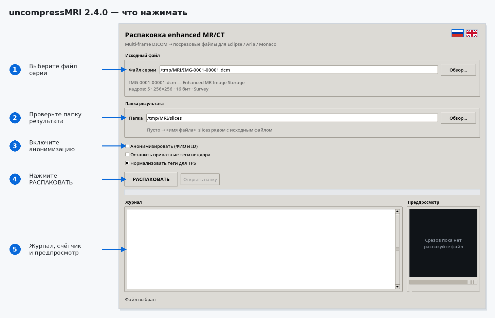
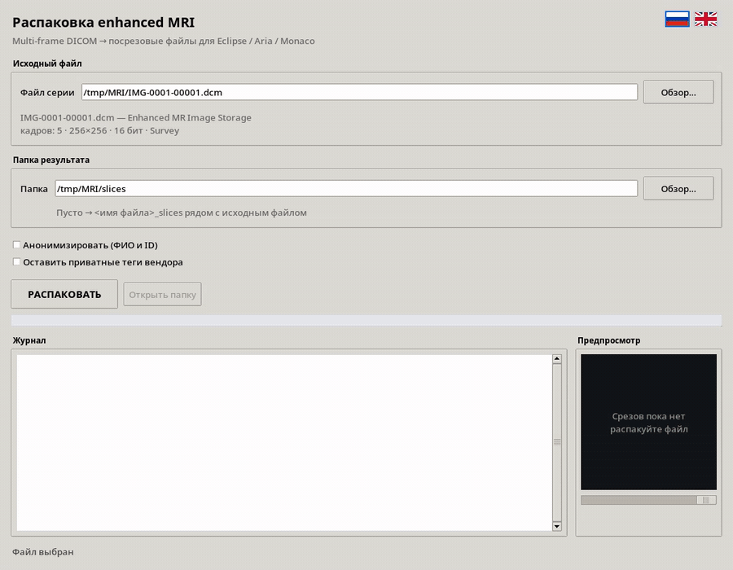
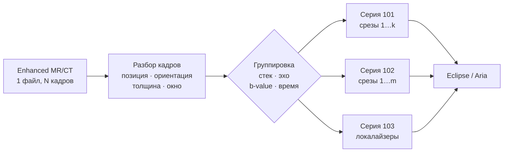

# uncompressMRI

**Режет «сжатую» multi-frame МРТ/КТ-серию на обычные посрезовые DICOM-файлы,
которые импортируются в Eclipse / Aria, Monaco и другие TPS.**

**Русский** · 🇬🇧 [English version](README.en.md)

[](https://github.com/loonies321/uncompressMRI/releases/latest)
[](https://github.com/loonies321/uncompressMRI/actions/workflows/ci.yml)
[](https://github.com/loonies321/uncompressMRI/actions/workflows/build-windows-exe.yml)
[](https://www.python.org/)
[](LICENCE.txt)
[](CODE_OF_CONDUCT.md)
[](CONTRIBUTING.md)
[](https://github.com/loonies321/uncompressMRI/releases)



**[Скачать uncompressMRI.exe](https://github.com/loonies321/uncompressMRI/releases/latest)** —
Windows x64, ~25 МБ, Python не нужен.
Или [запустить из исходников](#из-исходников).

---

## Зачем это

Аппарат (например, Philips) может записать всю серию одним файлом —
`Enhanced MR Image Storage` или `Enhanced CT Image Storage`, внутри которого
лежат десятки кадров. Eclipse и Aria такие файлы не принимают: им нужен набор
обычных `MR Image Storage` / `CT Image Storage`, по файлу на срез. Monaco
(Elekta) и другие TPS импортируют результат так же — это стандартные
single-frame объекты.

uncompressMRI разбирает multi-frame файл обратно на срезы, сохраняя
геометрию каждого кадра, а не «среднюю по больнице»:

| | |
|---|---|
| **Было** | 1 файл, 5 кадров, 3 стека, геометрия спрятана в per-frame functional groups |
| **Стало** | 5 файлов, 3 серии; у каждого среза свои `ImagePositionPatient`, `SliceLocation`, `InstanceNumber` |

## Три шага

1. **Выберите файл серии** — кнопка «Обзор…» или вставьте путь в поле.
   Под заголовком сразу появится, что внутри: SOP-класс, число кадров,
   матрица, описание серии. Если написано `Enhanced MR Image Storage` —
   файл тот самый.
2. **Проверьте папку результата** — по умолчанию `<имя файла>_slices`
   рядом с исходником.
3. **Нажмите `РАСПАКОВАТЬ`** — прогресс-бар покажет `записано / всего`,
   журнал — итог по сериям, кнопка «Открыть папку» откроет результат.
   Справа от журнала появляется **предпросмотр**: ползунок листает готовые
   срезы, окно яркости берётся из DICOM (`WindowCenter/WindowWidth`).

Горячие клавиши: `Enter` — распаковать, `Ctrl+O` — выбрать файл,
`Esc` — закрыть.

Язык интерфейса переключается флажками **RU / EN** в правом верхнем углу
окна (флажки нарисованы на `Canvas`, никаких внешних картинок) и
запоминается между запусками.



## Что получится в папке

```text
IMG-0001-00001_slices/
├── IM_101_0001.dcm   ← серия 101, срез 1
├── IM_101_0002.dcm
├── IM_101_0003.dcm
├── IM_102_0001.dcm   ← серия 102, другой стек
└── IM_103_0001.dcm   ← серия 103, локалайзер в другой плоскости
```

Имя файла: `IM_<номер серии>_<номер среза>.dcm`. У каждой серии свой
`SeriesInstanceUID`, поэтому в TPS серии не перемешаются, даже если лежат
в одной папке.

**Почему Study UID новый.** Eclipse помнит загруженные исследования по
`StudyInstanceUID`. Если оставить UID исходной enhanced-серии, TPS ответит,
что это исследование уже загружено, — и не пустит срезы. Поэтому по
умолчанию генерируется новый детерминированный UID: повторная распаковка
того же файла даёт тот же самый UID, а старое исследование не конфликтует.
Нужно именно «дописать» в исходное исследование — есть флаг
`--keep-study-uid`.

| Поле | Что с ним происходит |
|---|---|
| `SOPInstanceUID` | новый, детерминированный: повторный запуск даёт те же значения |
| `SeriesInstanceUID` | новый на каждую серию |
| `StudyInstanceUID` | **новый, детерминированный** — см. ниже, почему не старый |
| `FrameOfReferenceUID` | новый вместе с исследованием, детерминированный |
| `ImagePositionPatient`, `SliceLocation` | из per-frame functional groups **каждого** кадра |
| `Rows`, `Columns`, `BitsStored` | из источника, 12 бит в 16 остаются 12 битами |
| Приватные теги вендора | удаляются, можно оставить флагом `--keep-private` |
| `PatientName`, `PatientID` | из источника, либо обезличиваются флагом `--anon` |
| `SpecificCharacterSet` | нормализуется: Latin-1 для ASCII, UTF-8 для кириллицы |
| Отсутствующие Type 1/2 теги | заполняются безопасными значениями (`--no-harmonize` отключает) |
| КТ-углы стола | по умолчанию **не** обнуляются; включается `--zero-couch-angles` |

## Импорт в Eclipse / Aria

1. Импорт DICOM → указать папку `*_slices` **целиком** (не отдельный файл).
2. Появится **новое** исследование (ФИО и ID те же, `StudyInstanceUID`
   новый) — его и нужно открыть.
3. Если из одного файла получилось несколько серий — это нормально:
   локалайзеры и разные стеки лежат отдельными сериями.

## Командная строка

```bash
python main.py IMG-0001-00001.dcm                 # рядом появится IMG-0001-00001_slices/
python main.py IMG-0001-00001.dcm -o /data/slices
python main.py IMG-0001-00001.dcm --anon          # обезличить
python main.py IMG-0001-00001.dcm --keep-study-uid  # оставить старый Study UID
python main.py ./dicoms/*.dcm -o /data/out        # несколько файлов
python main.py ct_enhanced.dcm --zero-couch-angles # КТ: обнулить углы стола
python main.py file.dcm --no-harmonize            # не трогать отсутствующие теги
python main.py file.dcm --verify                  # перечитать все файлы после записи
```

| Ключ | Что делает |
|---|---|
| `-o`, `--output` | папка результата (по умолчанию `<имя>_slices`) |
| `--anon` | убрать ФИО/ID (Study UID и так новый) |
| `--keep-study-uid` | оставить исходный `StudyInstanceUID` |
| `--keep-private` | оставить приватные теги вендора |
| `--no-harmonize` | не заполнять отсутствующие TPS-теги и не менять charset |
| `--zero-couch-angles` | для КТ обнулить `PatientSupportAngle` и углы стола |
| `--force-16bit` | сохранить 8-битные пиксели как 16-битные |
| `--verify` | после записи перечитать все файлы (медленнее, максимально строго) |
| `--no-overwrite` | не перезаписывать существующие файлы |
| `-q` | тихий режим |
| `--version` | версия |

## Как это работает



1. Пиксели декодируются `pydicom` (для JPEG/JPEG-2000 нужен `pylibjpeg` или `python-gdcm`).
2. Из `Per-Frame Functional Groups` каждого кадра достаются позиция,
   ориентация, `PixelSpacing`, `SliceThickness`, окно, `RescaleSlope/Intercept`.
   Если per-frame данных нет — берутся `Shared Functional Groups`, затем
   значения верхнего уровня.
3. Кадры группируются в серии по `StackID`, ориентации, `FrameType`,
   номеру эха, b-value и только разрешённым контрастным/физическим
   значениям `Dimension Index`. Пространственные и временные индексы не дробят объём.
4. Каждый срез пишется как обычный `MR Image Storage` или `CT Image Storage`
   (explicit VR little endian)
   с пересчитанным `SliceLocation` (`IPP · normal`) и своим `InstanceNumber`.
5. Результат проверяется в памяти: длина `PixelData` = `Rows × Columns × 2`,
   позиции срезов уникальны. Флаг `--verify` дополнительно перечитывает файлы.
6. Если файл обрезан (Siemens иногда не дописывает концевой разделитель
   pixel data), чтение повторяется с восстановленным разделителем —
   в журнале появляется предупреждение, конвертация не падает.

<details>
<summary>Что было сломано в версии 1.x (поэтому конвертер переписан)</summary>

| Было | Стало |
|---|---|
| Путь `etalonnoeMRI\file` — работало только в Windows | `os.path.join`, Linux/macOS/Windows |
| Все кадры сваливались в одну серию | группировка по стеку / эху / b-value / времени |
| Ориентация и позиция брались из 0-го кадра | геометрия из per-frame functional groups каждого кадра |
| `SliceLocation` оставался от эталона у всех срезов | пересчитывается как `IPP · normal` |
| `Rows/Columns` подменялись, `BitsStored` терялся | размер и битность из источника |
| `ndarray.tostring()` — удалён в NumPy 2.x | `tobytes()` |
| Мёртвая функция `write_dicom` | удалена |
| Нужна была папка `etalonnoeMRI` с чужим срезом | срезы строятся из исходного файла |
| Вывод в текущую папку как `after0.dcm` | в `<имя>_slices/`, имена `IM_<серия>_<номер>.dcm` |

</details>


## Скорость

В 2.4.0 убраны глубокие копии больших enhanced-датасетов, проверка
результата перенесена в память (без повторного чтения каждого файла), а
группировка больше не раздувает объём из-за пространственных Dimension Index.

На синтетическом файле из 800 кадров 256×256 внутренний тест занимает около
**2,5 с** (≈320 кадров/с) против ≈3,6 с в 2.3.1 на той же машине — примерно на
30% быстрее. Основное оставшееся время — запись 800 отдельных DICOM-файлов;
если нужна максимальная строгость, `--verify` перечитывает их после записи.

## Тесты и сборка

```bash
python -m pip install -r requirements-dev.txt
python -m pytest tests -q      # 38 тестов
```

Тесты строят синтетический enhanced-файл (Philips-подобная структура,
2 стека, 12-битные пиксели) и проверяют разбиение на серии, побитовое
совпадение пикселей, геометрию, UID, обезличивание, harmonization,
charset, КТ-вывод, защиту от дробления объёма пространственными Dimension
Index, прогресс, починку обрезанного файла, отрисовку предпросмотра и
отсутствие захардкоженных данных пациента. Отдельный тест прогоняет реальный
пример `IMG-0001-00001.dcm`.

Windows-сборка автоматическая: тег `v*` поднимает GitHub Actions, который
прогоняет тесты, собирает exe через PyInstaller, **запускает уже собранный
файл на реальной Windows** (enhanced-файл → 5 срезов / 3 серии, одиночный
срез → 1 файл) и прикрепляет его к релизу.

Даже картинки в этом README сделаны не руками: `tools/make_screenshots.py`
поднимает настоящее окно, прогоняет конвертацию и снимает скриншоты и GIF
(`ImageMagick` + `ffmpeg`).

### Из исходников

```bash
git clone https://github.com/loonies321/uncompressMRI.git
cd uncompressMRI
python -m pip install -r requirements.txt
python main.py                     # окно
python main.py file.dcm -o out     # консоль
```

Нужен Python 3.10+ (проверено на 3.10 и 3.12).

### Собрать exe локально (Windows)

```bat
python -m pip install -r requirements-dev.txt pyinstaller
build_exe.bat
```

Результат: `dist\uncompressMRI.exe`. Кросс-компиляции нет: PyInstaller
собирает только под ту ОС, где запущен.

## Ограничения

* Цветные enhanced-MR (`Enhanced MR Color Image Storage`) не поддерживаются.
* КТ-углы стола по умолчанию сохраняются как в источнике. Если TPS требует
  нулевые углы, включайте `--zero-couch-angles` осознанно: это меняет геометрию.
* Harmonization заполняет только **отсутствующие** теги. Значения `UNKNOWN`,
  `000000`, `0.0` — безопасные заглушки, а не догадки о пациенте;
  перед клиническим использованием результат нужно проверить.
* Сжатые JPEG/JPEG-2000 файлы требуют `pylibjpeg` или `python-gdcm`.
* Если позиции нет ни в per-frame, ни в shared, ни в top-level тегах,
  срезы восстанавливаются по толщине — программа предупредит, результат
  нужно проверить глазами.
* DWI с несколькими направлениями градиента группируется по b-value,
  направления отдельными сериями не разделяются.

## Если что-то пошло не так

**Windows пишет «Windows защитила ваш компьютер».** exe не подписан
платным сертификатом: «Подробнее» → «Выполнить в любом случае». SHA-256
файла указан в описании релиза — можно сверить.

**В Eclipse не появились срезы.** Импортировать нужно папку `*_slices`
целиком и открыть новое исследование (Study UID у результата новый).

**Eclipse пишет, что исследование уже загружено.** Значит, файлы собраны
с флагом `--keep-study-uid` или старой версией программы: уберите флаг и
распакуйте заново.

**Siemens: «файл обрезан» / программа не открывает файл.** Начиная с 2.3.0
концевой разделитель pixel data восстанавливается автоматически; если
предупреждение осталось, пришлите файл — посмотрю.

**«Файл не является DICOM».** Файл может быть сжат JPEG/JPEG-2000 —
поставьте `pylibjpeg` (из исходников) или пришлите файл, добавлю поддержку.

**Из одного файла вышло несколько серий.** Так и должно быть: в исходнике
несколько стеков (например, локалайзеры в трёх плоскостях). Пространственные
Dimension Index (позиция среза, Instance Number, время кадра) больше не дробят
один объём на отдельные серии.

**В логе появилось `TPS harmonization`.** Это список заполненных отсутствующих
тегов и/или исправленный `SpecificCharacterSet`. Если менять ничего не нужно,
используйте `--no-harmonize`.

**В результате не то ФИО.** Оно берётся из исходного файла, ничего не
подставляется. Для обезличивания — `--anon` или галочка в окне.

## Участие в проекте

Проект открыт для отчётов об ошибках, идей и pull request'ов.

- [CONTRIBUTING.md](CONTRIBUTING.md) — как запустить тесты, что можно менять и каких ограничений держаться.
- [CODE_OF_CONDUCT.md](CODE_OF_CONDUCT.md) — правила общения.
- [SECURITY.md](SECURITY.md) — как сообщить об уязвимости.
- [CHANGELOG.md](CHANGELOG.md) — что изменилось между версиями.
- Шаблоны issue: [bug report](.github/ISSUE_TEMPLATE/bug_report.yml) и [feature request](.github/ISSUE_TEMPLATE/feature_request.yml).

**Важно:** публичные issue приветствуются, включая критику. Но не прикладывайте реальные DICOM-данные пациентов: ответственность за медицинские и персональные данные в публикации лежит на авторе. Для примеров используйте синтетические файлы или обезличьте их (`--anon`) и проверьте перед публикацией.

Если инструмент сэкономил вам время, звезда помогает другим медицинским физикам его найти.

## Лицензия

Apache License 2.0 — см. [LICENCE.txt](LICENCE.txt).

Сторонние компоненты и их лицензии — [THIRD_PARTY_NOTICES.md](THIRD_PARTY_NOTICES.md).

`инструкция.pdf` в репозитории описывает версию 1.x (с папкой
`etalonnoeMRI`) и устарела — актуальна эта README.

---

## English summary

Full English README: **[README.en.md](README.en.md)**.

`uncompressMRI` converts **enhanced (multi-frame) MR and CT DICOM**
(Philips `Enhanced MR Image Storage`, `Enhanced CT Image Storage`) into plain
**single-frame `MR Image Storage` / `CT Image Storage`** slices that Varian
**Eclipse** / **Aria** and other treatment planning systems (Oncentra, Monaco,
RayStation) can import.

It is a DICOM splitter/converter for radiotherapy: per-frame geometry
(position, orientation, spacing, thickness), series splitting by
stack/echo/b-value, a conservative TPS harmonization mode (charset, missing
Type 1/2 tags), deterministic UIDs (a new `StudyInstanceUID`, so Eclipse
does not treat the result as an already-imported study), anonymization,
optional CT table-angle zeroing, Windows `.exe`, CLI and GUI.

<sub>dicom · dicom converter · dicom splitter · enhanced MR · enhanced CT ·
multi-frame · MRI · CT · radiotherapy · radiation oncology · medical physics ·
treatment planning system · Varian Eclipse · Varian Aria · Philips · pydicom ·
Python</sub>
